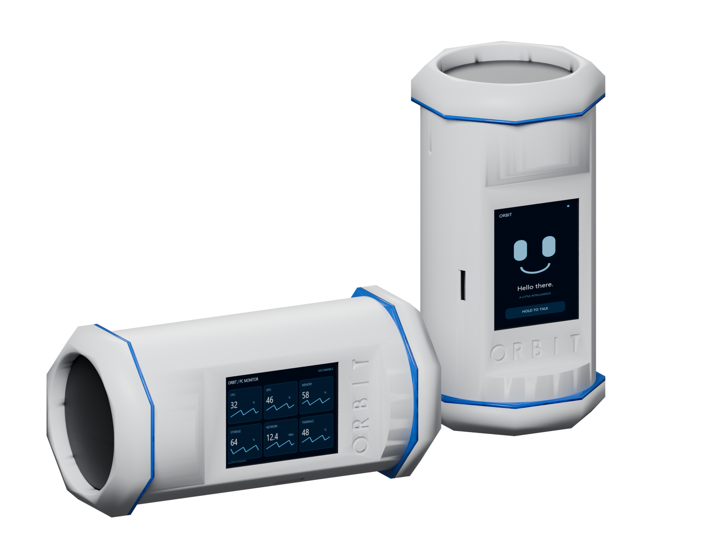
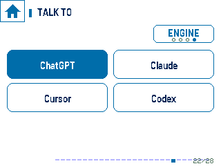
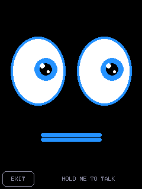
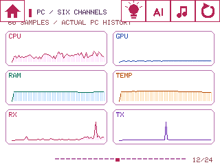
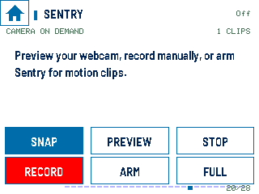
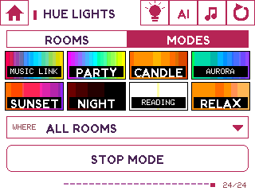
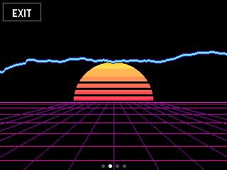

# Orbit


A tabletop ESP32 device and Windows companion for working with multiple AIs, monitoring a PC and handling approval requests away from the keyboard.

Created by **Seth Fandetti**. This is the working **Capsule v1 prototype**. It is fun to use; the next goal is to make it smaller, develop a dedicated circuit board and eventually offer an assembled version for sale. That smaller board and production product are still in development.



## Start here

- [Software setup](docs/SETUP.md)
- [Hardware parts list — board, mic, amplifier, speaker, power and lights](hardware/README.md)
- [Downloadable parts list](hardware/CAPSULE-PARTS.csv)
- [Device screenshot gallery — landscape and portrait](docs/SCREENSHOTS.md)
- [Illustrated build guide](hardware/Build_guide/Orbit_Build_Guide.html) — download and open the HTML in a browser
- [Contributing](CONTRIBUTING.md) · [Release status](docs/RELEASE-CHECKLIST.md) · [Licenses](LICENSING.md)

## AI connections

The ENGINE screen lists configured connections. ChatGPT uses OpenAI Realtime voice. Claude, DeepSeek and Cursor answer in text; OpenAI speech services handle speech input and output for those engines. Cursor requires the locally installed agent. Codex is a separately paired coding conversation with reviewed SEND / CANCEL commands.

Configure your own credentials on the PC. Provider accounts and API charges are separate from Orbit; a consumer chat subscription does not automatically include API credit. Current conversations are held in memory and a restart starts fresh conversations.

 

## PC telemetry and controls

- CPU/GPU, RAM/VRAM, temperatures and available power/fan readings.
- Six-channel dashboard; dedicated network, storage, CPU, GPU and thermal views.
- Media controls and six configured application/command shortcuts.
- Privacy guard for explicitly selected local folders and supported browser data; destructive actions require review and confirmation.
- AI Sentry: webcam preview, snapshots, local recordings and motion clips. Camera imagery is not sent to an AI provider by Sentry.

 

## Party tricks

Philips Hue room controls, brightness, moods and music-reactive lighting. Music Link follows beat/audio levels from the visualizer; STOP MODE restores remembered light settings. Hue requires a compatible bridge and lights paired through the companion.

Two LED rings, selectable effects, four visualizations, an animated face, clocks, a focus timer and stopwatch. Landscape and portrait UI layouts are included.

 

## Repository map

| Folder | Contents |
| --- | --- |
| `software/` | Node companion, console, simulator, tests and legacy reference code |
| `software/firmware/` | OrbitDevice and OrbitSpeaker ESP32 programs |
| `hardware/` | Capsule CAD, STL, print plates, bill of materials and illustrated guides |
| `website/` | Buildless MeetOrbit site, screenshots and source/download resources |
| `docs/` | Setup, screenshots, validation and release notes |
| `branding/` | Orbit symbolic mark as SVG and uploadable PNG |

## Run the companion

Install a current Node.js LTS version, then:

```powershell
cd software
npm ci
npm start
```

Open http://127.0.0.1:8910. Read [SETUP.md](docs/SETUP.md) before firmware, pairing or hardware work. Do not start a second companion on a port already used by an installed Orbit.

## Status and limits

This is development source, not a signed installer or a matched prebuilt firmware release. Provider integrations, hardware and host configuration need their own setup. The device screenshots are direct UI captures, not photographs or evidence of a completed end-to-end test. Network and pairing-detail screenshots are omitted.

Original development and installed Orbit files were not modified to publish this repository. Do not commit API keys, Wi-Fi secrets, browser profiles, pairing tokens or recordings.

## License

Original software/firmware/website: **MIT**. Original hardware and build documentation: **CERN-OHL-P-2.0**. Font and dependency licenses are retained separately. See [LICENSING.md](LICENSING.md).
