# Device screenshots

Updated from the saved capture folder on 28 October 2026. No hardware capture or display-control requests were made to prepare this update. Original images are preserved: 42 landscape, 42 portrait and 8 theme samples. Network/pairing details are excluded. One landscape file named ai-face contains an alternate Home view; its gallery label reflects the actual image.

## Home and AI

### Home shortcuts

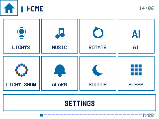 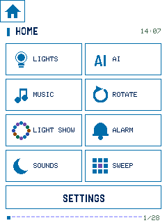

### AI engine picker

 

### AI console

 

## Alarm and ambient sounds

### Alarm clock

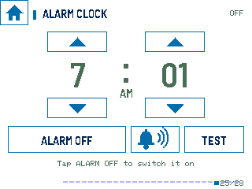 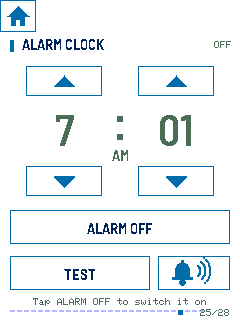

### Alarm ringing / snooze

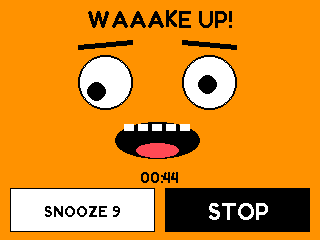 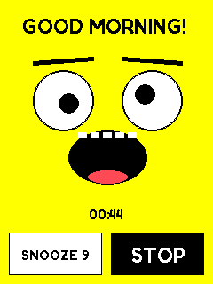

### Ambient sound machine

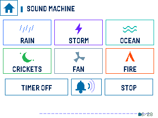 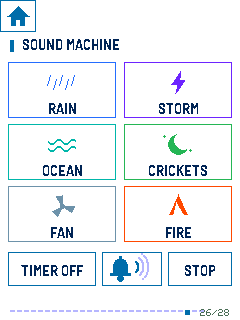

## Hue and lighting

### Hue room controls

 

### Hue modes / Music Link

 

### LED light show

 

## PC and camera

### Six-channel dashboard

 

### PC Matrix

 

### AI Sentry

 

## Games

### Orbit Sweep

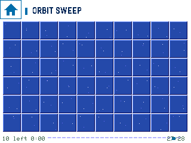 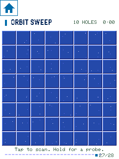

### Orbit Run

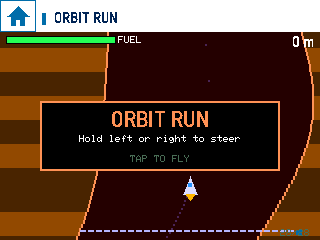 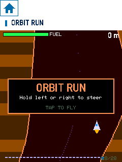

## Four themes

### Office

 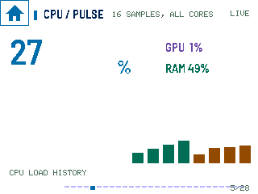

### Retro

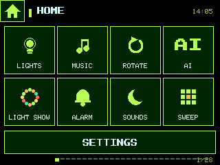 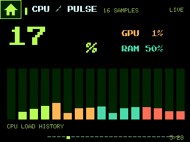

### Cyberpunk

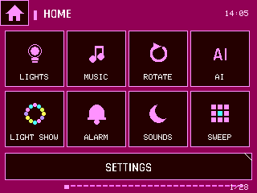 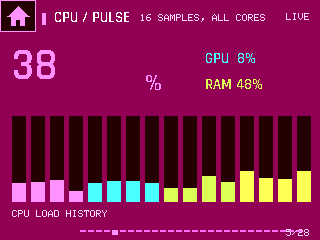

### Bubblegum

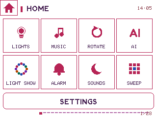 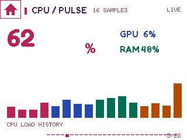

[All landscape captures](../website/assets/screens/lying/) · [All portrait captures](../website/assets/screens/standing/) · [Image hashes](SCREENSHOT-MANIFEST.json)
