# Device screen gallery

Direct UI captures from the current development build, supplied on 28 October 2026. Landscape is 320 x 240; portrait is 240 x 320. Original files are preserved. These are UI captures, not photographs or proof of end-to-end hardware validation. Network and pairing-detail screens are omitted.

## AI

### Engine picker

 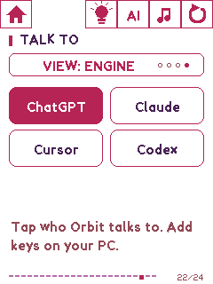

### AI console

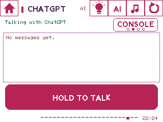 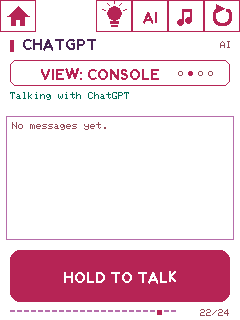

### Voice

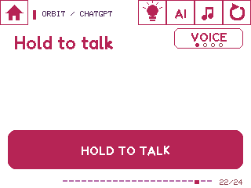 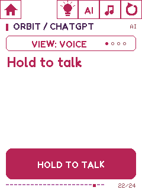

### Face

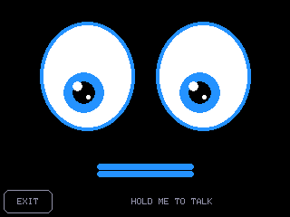 

## PC telemetry

### PC Matrix

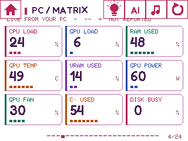 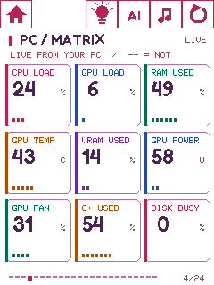

### Six channels

 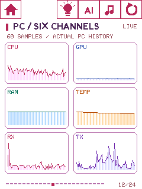

### Cpu Pulse

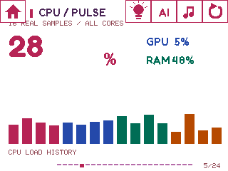 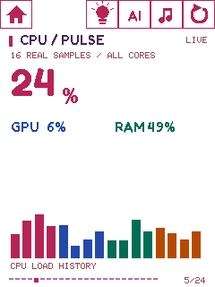

### Gpu Engine

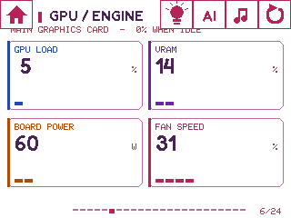 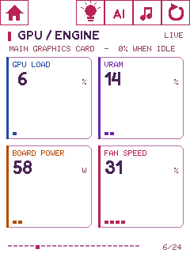

## Controls and privacy

### Privacy guard

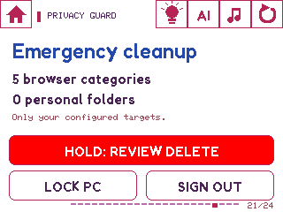 

### Sentry

 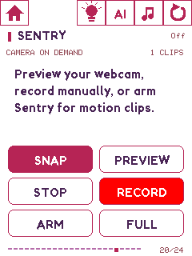

### App Launcher

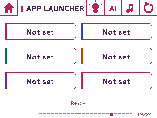 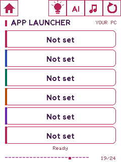

### Music

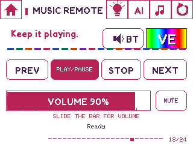 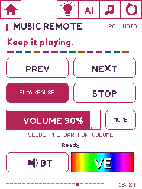

## Hue and party tricks

### Hue rooms

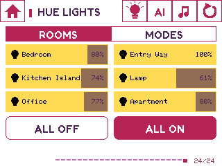 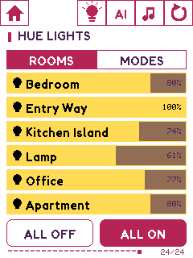

### Hue modes

 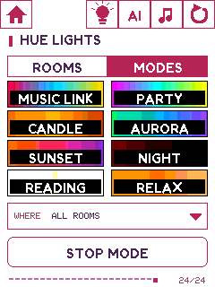

### LED light show

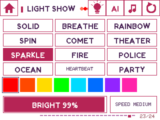 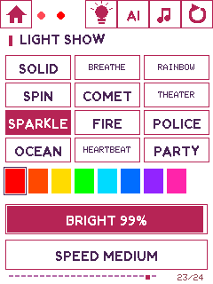

### Visuals 2

 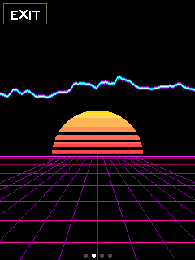

### Visuals 3

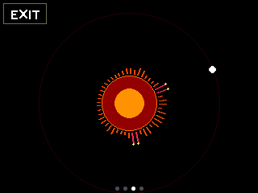 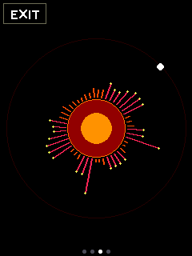

[All landscape captures](../website/assets/screens/lying/) · [All portrait captures](../website/assets/screens/standing/)
